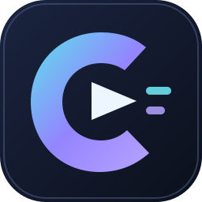

<p align="center">
  
</p>

<p align="center">
  <strong>Локальный ИИ-помощник для монтажа игровых видео</strong><br>
  Находит интересные моменты, помогает собрать динамичную нарезку и экспортировать результат в MP4.
</p>

<p align="center">
  <a href="https://github.com/Zeihos/CLIPTORA/actions/workflows/ci.yml"></a>
  
  
  
  <a href="LICENSE"></a>
</p>

<p align="center">
  <a href="#-быстрый-запуск"><b>Начать работу</b></a> ·
  <a href="#-возможности"><b>Возможности</b></a> ·
  <a href="docs/INSTALL_RU.md"><b>Установка</b></a> ·
  <a href="CHANGELOG.md"><b>История версий</b></a> ·
  <a href="CONTRIBUTING.md"><b>Участие в разработке</b></a>
</p>

---

## ◈ Что такое CLIPTORA?

**CLIPTORA** — бесплатный проект с открытым исходным кодом для Windows. Он помогает превратить длинные игровые записи в подборку моментов, которые затем можно проверить и подредактировать вручную.

Программа работает **локально**: сканирует выбранную папку, анализирует динамику звука и изображения, при необходимости распознаёт речь через `faster-whisper`, предлагает сцены и экспортирует видео с помощью **FFmpeg**. Для подсказок по диалогам можно дополнительно использовать локальный **Ollama**.

> [!IMPORTANT]
> **Текущий статус — Alpha 0.1.15.** Это помощник для первичного отбора и монтажа, а не полноценная замена DaVinci Resolve или Premiere Pro. CLIPTORA пока не умеет достоверно понимать юмор, мемы или события конкретной игры. Все автоматически выбранные моменты нужно просматривать. Готового установщика `.exe` и подтверждённого стресс-теста на 250 ГБ пока нет.

## ✦ Возможности

| Функция | Что доступно сейчас |
| :--- | :--- |
| **Библиотека записей** | Сканирование папок, сохранение идентификаторов видео и повторный анализ только при изменениях |
| **Поиск моментов** | Звуковые всплески, движение, подводка и продолжение реакции; объяснение причины выбора |
| **Распознавание речи** | Необязательный локальный `faster-whisper`; поддержка подсказок через Ollama |
| **Варианты монтажа** | Сбалансированный, диалоговый и экшен; сравнение перед применением |
| **Ручная доводка** | Границы сцен, порядок, включение/отключение фрагментов, лёгкий зум, история черновиков |
| **Проверка качества** | Сравнение с вручную отмеченными моментами: Precision, Recall, F1 |
| **Предпросмотр** | MP4 в 480p для первых 120 секунд будущего монтажа |
| **Экспорт** | MP4 в 480p / 720p / 1080p и SRT; темп, нормализация звука и короткие переходы |
| **Длинные задачи** | Сохраняемая очередь анализа, повтор ошибок и ограничение числа CPU-потоков |
| **Rust Core** | Необязательный быстрый сканер метаданных с автоматическим резервным Python-режимом |

## ⚡ Быстрый запуск

**Требования:** Windows 10/11, **Python 3.12**, FFmpeg и FFprobe. Rust и модели ИИ — по желанию.

1. Скачайте исходники через **[Code → Download ZIP](https://github.com/Zeihos/CLIPTORA/archive/refs/heads/main.zip)** и распакуйте отдельно от папки с видеозаписями.
2. Запустите **`SETUP_WINDOWS.bat`** — он поможет проверить Python 3.12 и FFmpeg.
3. При необходимости установите распознавание речи через **`INSTALL_AI_WINDOWS.bat`**.
4. Запустите **`START_WINDOWS.bat`**. Интерфейс откроется в браузере по адресу **http://127.0.0.1:8765**.
5. Выберите папку с записями → **Сканировать** → **Анализировать** → **Создать подборку** → **Проверить клипы** → **Экспорт MP4**.

<details>
<summary><b>Ручной запуск и необязательный Rust Core</b></summary>

Запуск локального сервера:

```powershell
py -3.12 server.py
```

Для Rust-сканера установите [rustup](https://rustup.rs/) и запустите `BUILD_RUST_WINDOWS.bat`. Без Rust программа продолжит работать через Python. Rust ускоряет только инвентаризацию файлов, **не** работу Whisper или кодирование FFmpeg.

Первый запуск `faster-whisper` может потребовать загрузки весов модели. Без установки AI-пакета доступна базовая работа со звуком и движением.

</details>

**Подробная инструкция:** [Установка на Windows](docs/INSTALL_RU.md).

## 🔒 Конфиденциальность и файлы проекта

- Исходные видео читаются по месту и не должны перезаписываться программой.
- Проекты, предпросмотры и экспорт сохраняются локально в `%USERPROFILE%\CLIPTORA\` (или ранее использовавшейся папке проекта).
- **По умолчанию видео не отправляются в облако.** Загрузка моделей при первичной установке возможна.
- Интерфейс работает на `127.0.0.1:8765`. **Не открывайте этот порт в Интернет.**
- Перед экспериментами с черновиком сохраняйте резервную копию `project.json`.

## 🧭 Планы развития

- [x] Поиск звуковых реакций и диалоговых сцен
- [x] Варианты автоматической подборки и отмена применения
- [x] Локальный предпросмотр, MP4 и субтитры SRT
- [x] Проверка качества по ручной разметке
- [x] Необязательный Rust-сканер и восстановление очереди
- [ ] Более точное понимание игровых событий и контекста шуток
- [ ] Полноценная многодорожечная монтажная шкала
- [ ] Установщик Windows `.exe`
- [ ] Тестирование на библиотеке около 250 ГБ

## 📚 Документация

| Раздел | Ссылка |
| :--- | :--- |
| Установка на Windows | [docs/INSTALL_RU.md](docs/INSTALL_RU.md) |
| Возможности и ограничения | [docs/FEATURE_GUIDE.md](docs/FEATURE_GUIDE.md) |
| Как устроен проект | [docs/ARCHITECTURE.md](docs/ARCHITECTURE.md) |
| Тестирование | [docs/TESTING.md](docs/TESTING.md) |
| История обновлений | [CHANGELOG.md](CHANGELOG.md) |
| Как помочь проекту | [CONTRIBUTING.md](CONTRIBUTING.md) |
| Безопасность | [SECURITY.md](SECURITY.md) |

## 🤝 Разработка и обратная связь

Нашли ошибку или хотите предложить функцию? Создайте [обращение (Issue)](https://github.com/Zeihos/CLIPTORA/issues/new/choose). Перед публикацией логов удалите личные пути, записи голоса и приватные данные. Pull Request приветствуются — [правила участия](CONTRIBUTING.md).

CLIPTORA распространяется по лицензии **[MIT](LICENSE)**. Лицензии FFmpeg, моделей и других сторонних компонентов определяются отдельно.

<p align="center">
  <br>
  <sub>CLIPTORA · Сделано <a href="https://github.com/Zeihos">Zeihos</a> · Разработка продолжается</sub>
</p>
