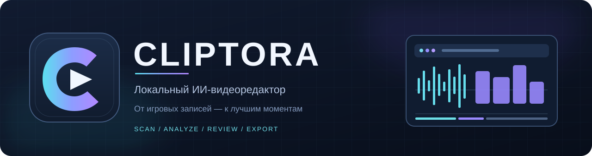

<p align="center">
  
</p>

<h1 align="center">CLIPTORA</h1>

<p align="center">
  <strong>Находи интересные моменты. Собирай нарезки. Монтируй на своём ПК.</strong><br />
  Бесплатный редактор игровых видео с локальным анализом звука, речи и движения.<br />
  Открытый исходный код · Windows · Python + FFmpeg · Rust Core (необязательно)
</p>

<p align="center">
  <a href="https://github.com/Zeihos/CLIPTORA/actions/workflows/ci.yml"></a>
  
  
  
  <a href="LICENSE"></a>
</p>

<p align="center">
  <a href="#-быстрый-запуск">Быстрый запуск</a> ·
  <a href="#-возможности">Возможности</a> ·
  <a href="docs/FEATURE_GUIDE.md">Руководство</a> ·
  <a href="CHANGELOG.md">История версий</a> ·
  <a href="CONTRIBUTING.md">Помочь проекту</a>
</p>

---

> [!IMPORTANT]
> **CLIPTORA 0.1.19 Alpha** — экспериментальная версия для **поиска и ручной доработки предложенных сцен**. Это пока не автономный профессиональный монтажёр: программа не гарантирует распознавания шуток, побед, эмоций и игровых событий. Экспериментальная Portable-сборка `.exe` уже доступна через GitHub Actions (это не установщик); масштабный стресс-тест на **250 ГБ** не проведён.


### Windows Portable EXE (экспериментально)

Для тех, кто не хочет устанавливать Python: GitHub Actions собирает два архива: **CLIPTORA-Windows-Portable-Core** (компактный, без ИИ распознавания речи) и **CLIPTORA-Windows-Portable-AI** (с библиотеками `faster-whisper`). В обеих версиях доступны `CLIPTORA.exe`, интерфейс и Rust Core. **FFmpeg/FFprobe устанавливаются отдельно, а модели Whisper скачиваются при первом распознавании**.

**[Скачать Portable через GitHub Actions](https://github.com/Zeihos/CLIPTORA/actions/workflows/windows-portable.yml)** · [Инструкция на русском](docs/INSTALL_PORTABLE_RU.md). Не отделяйте `.exe` от папки `_internal`.


**Проверка речевого ИИ в AI-редакции:** для своего тестового MP4 можно выполнить
`CLIPTORA.exe --test-whisper "C:\Видео\фрагмент.mp4" --whisper-test-model tiny --whisper-test-language ru`.
Первый запуск может загрузить модель; выводится только количество распознанных сегментов, без текста речи.
CI дополнительно тестирует AI-редакцию на видео с синтезированной английской речью.

## ✦ Зачем нужна CLIPTORA

Когда записей много, поиск удачных моментов занимает часы. CLIPTORA помогает **сделать первый черновой монтаж**: сканирует видео, ищет вероятные реакции и активные сцены, предлагает несколько вариантов подборки и позволяет проверить результат до экспорта.

**Всё важное происходит локально.** Исходные видео читаются из выбранной папки и не отправляются в облако по умолчанию. Для распознавания речи можно установить локальный `faster-whisper`; при первом использовании модель может скачиваться из интернета.

## ⚡ Быстрый запуск

**Для запуска из исходников понадобится:** Windows 10/11, **Python 3.12**, **FFmpeg** и **FFprobe**. Rust и ИИ-модели — по желанию.

1. Скачай репозиторий через **[Code → Download ZIP](https://github.com/Zeihos/CLIPTORA/archive/refs/heads/main.zip)** и распакуй в отдельную папку **вне папки с исходными видео**.
2. Установи [Python 3.12](https://www.python.org/downloads/) и запусти **`SETUP_WINDOWS.bat`** — он проверит Python и FFmpeg (при наличии `winget` может предложить установку FFmpeg).
3. Запусти **`START_WINDOWS.bat`** и открой **http://127.0.0.1:8765**.
4. Выбери папку с записями → **Сканировать → Анализировать → Сравнить 3 варианта** → проверь клипы → собери предпросмотр → экспортируй MP4.

<details>
<summary><strong>Дополнительно: распознавание речи и Rust Core</strong></summary>

- **`INSTALL_AI_WINDOWS.bat`** — установка `faster-whisper` для локального распознавания речи. При первом запуске потребуется скачать модель.
- **`BUILD_RUST_WINDOWS.bat`** — сборка необязательного файлового сканера после установки [Rust](https://rustup.rs/). Без Rust CLIPTORA работает через Python.
- **Ручной запуск:** из папки программы `py -3.12 server.py`.

</details>

Подробности и решение типичных проблем — в **[инструкции по установке на Windows](docs/INSTALL_RU.md)**.

## 🎬 Возможности

| Направление | Что доступно в текущей Alpha |
| :-- | :-- |
| **Видеобиблиотека** | Рекурсивное сканирование, сохранение идентификаторов записей и повторное сканирование только изменённых файлов |
| **Поиск моментов** | Звуковые всплески, движение в кадре, контекст диалогов, адаптивные границы реакций и фильтрация похожих сцен |
| **Локальный ИИ** | Распознавание речи через `faster-whisper`; необязательные подсказки по диалогам через локальный Ollama |
| **Варианты нарезки** | Сбалансированный, диалоговый и экшен; предпросмотр без замены ручного монтажа |
| **Редактирование** | Изменение границ, порядка, подписей, зума и включения сцен; возможность отмены применения подборки |
| **Предпросмотр** | Отдельный MP4 в **480p**, до первых **120 секунд** готового монтажа |
| **Экспорт** | MP4 до **1080p**, SRT, опциональная нормализация громкости, короткие затухания и сокращение тихих пауз |
| **Очередь** | Сохранение состояния анализа по каждому видео, повтор ошибок и продолжение после перезапуска |
| **Проверка качества** | Сравнение автоматической подборки с ручными отметками: **Precision, Recall, F1** (совпадение интервалов, не «оценка юмора») |

**Принцип работы**

```text
Исходные видео
      ↓
Сканирование → Анализ звука / движения / речи
      ↓
Поиск кандидатов → Сравнение трёх вариантов
      ↓
Ручная правка → Предпросмотр → Экспорт MP4 + SRT
```

Необходимость ручной проверки — **часть текущего рабочего процесса**, а не скрытое ограничение.

## 🧩 Как устроен проект

| Компонент | Назначение |
| :-- | :-- |
| `engine.py` и вспомогательные `.py` | Анализ, оценка сцен, монтажные планы, настройки и экспорт |
| `server.py` + `web/` | Веб-интерфейс и локальный API на `127.0.0.1:8765` |
| `scanner_bridge.py` + `rust/scanner/` | Необязательное ускоренное перечисление видеофайлов с резервным Python-сканером |
| `assets/` | Фирменная графика CLIPTORA |
| `tests/` | Автоматические тесты |
| `docs/` | Инструкции по установке, функциям, архитектуре и проверкам |

> **Rust Core не обрабатывает видео и не ускоряет Whisper.** Он только собирает метаданные файлов. Декодирование и экспорт выполняет FFmpeg, а обработку и логику монтажа координирует Python.

## 🔒 Приватность и безопасность

- Исходные видео **не должны изменяться**: CLIPTORA читает их из выбранной папки, а результаты сохраняет отдельно.
- Данные проекта по умолчанию находятся в **`%USERPROFILE%\CLIPTORA\`** (`project.json`, `cache/`, `previews/`, `renders/`).
- Интерфейс доступен на **`127.0.0.1:8765`**. **Не открывай этот порт в интернет:** у локального API нет авторизации для публичного доступа.
- Перед массовым редактированием сохрани копию **`project.json`**. Не публикуй свои записи, стенограммы, ключи и файлы моделей в GitHub.

Подробнее: [безопасность](SECURITY.md) и [архитектура](docs/ARCHITECTURE.md).

## 🗺️ Что дальше

| Статус | Направление |
| :-- | :-- |
| ✅ Реализовано | Локальный анализ, подборки, ручная правка, предпросмотр и MP4/SRT |
| 🧪 Экспериментально | Отбор кульминаций, оценка диалогов, качество автоматических нарезок |
| 🛠️ В планах | Полноценный установщик Windows, более гибкий таймлайн, эффекты, измерение скорости на больших библиотеках |

Никаких неподтверждённых процентов готовности или обещаний автоматического монтажа «как у профессионала» — развитие проекта фиксируется в [истории изменений](CHANGELOG.md).

## 🤝 Участие в разработке

Нашёл ошибку или придумал улучшение? Создай [Issue](https://github.com/Zeihos/CLIPTORA/issues/new/choose) или предложи [Pull Request](https://github.com/Zeihos/CLIPTORA/pulls). Все основные инструкции и шаблоны доступны на русском.

**Документация:** [установка](docs/INSTALL_RU.md) · [функции](docs/FEATURE_GUIDE.md) · [архитектура](docs/ARCHITECTURE.md) · [тесты](docs/TESTING.md) · [подготовка релиза](docs/RELEASE_CHECKLIST.md) · [история версий](CHANGELOG.md) · [вклад](CONTRIBUTING.md)

<p align="center">
  <sub>Разработка: <a href="https://github.com/Zeihos">Zeihos</a> · Исходный код: <a href="LICENSE">MIT</a> · FFmpeg и модели распространяются на условиях их собственных лицензий.</sub>
</p>

> **Совместимость речевого ИИ:** для `faster-whisper==1.2.1` используется `av==18.1.0`. Более новый PyAV 19 несовместим с этой версией распознавания; установщик AI закрепляет проверенную версию.
