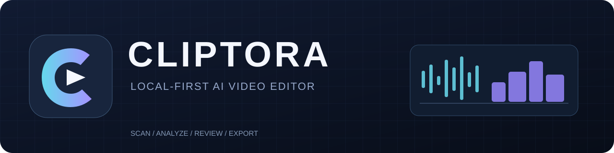

<p align="center"></p>

<p align="center">
  <strong>CLIPTORA</strong> — a free, open-source, local-first video highlight editor for Windows.<br>
  Scan your footage, analyze speech and activity, review the best moments, and export a cut.
</p>

<p align="center">
  
  
  
  
</p>

> [!IMPORTANT]
> **Alpha 0.1.3**. This is an experimental *first-cut/highlight selection* app, **not** a fully autonomous professional editor. It cannot reliably understand humor, game events, or comedic timing. Review selected clips before publishing. No 250 GB performance claim has been verified.

## What it can do today

| Area | Supported in the alpha |
| --- | --- |
| Library | Recursively scan a user-selected folder of videos |
| Analysis | Audio peaks and optional visual motion; optional local speech recognition via `faster-whisper` |
| Context | Keep surrounding dialogue and manually edit clip start/end |
| AI | Optional **local** Ollama for scoring dialogue (quality is experimental) |
| Review | Browser preview, enable/disable, adjust clips and mark subtle zooms |
| Export | FFmpeg MP4 at 480p / 720p / 1080p and transcript-derived SRT |
| Processing | Localhost server; preserves source files; resumable per-file analysis |

**Not yet implemented:** automatic meme selection, precise semantic scene understanding, motion tracking, elaborate keyframed effects, professional audio mixing, a standalone `.exe` installer, or a multi-track timeline.

## Quick start — Windows

1. Install **Python 3.12** (not 3.15). The Windows launchers explicitly select 3.12.
2. Unzip this repository somewhere outside your footage directory.
3. Run `SETUP_WINDOWS.bat` to check Python and FFmpeg (the script can install FFmpeg with `winget`).
4. Optional: run `INSTALL_AI_WINDOWS.bat` for `faster-whisper` speech recognition. Skip if already installed under Python 3.12.
5. Run `START_WINDOWS.bat`; open <http://127.0.0.1:8765> if the browser does not start.
6. Select the source footage folder → **Scan** → **Analyze** → **Create selection** → review clips → **Export MP4**.

The first Whisper transcription may download model weights from the Internet. Afterwards the model can run locally. For dialogue scoring you can optionally install [Ollama](https://ollama.com/) and download a model; it is **not required**.

Read [УСТАНОВКА.txt](УСТАНОВКА.txt) for Russian instructions.

### Manual server start

```powershell
py -3.12 server.py
```

This script uses Python's standard-library HTTP server and binds to `127.0.0.1` only. `FFmpeg` and `ffprobe` must be on PATH (or in `tools/`).

## Privacy, storage and migration

- Sources are read in place and never intentionally overwritten or deleted.
- New project state and exports are under `%USERPROFILE%\CLIPTORA\` (`project.json`, `renders/`, `cache/`).
- If you already have a project from **Zeihos AI Montage Studio** and the new CLIPTORA data folder does not contain a project, CLIPTORA keeps using the legacy data directory to avoid copying large caches and breaking existing project paths.
- By default, **no footage is uploaded to a cloud service**. Whisper weights may download once, and Ollama is expected on `127.0.0.1`. Do not expose port 8765 to public networks.
- Do not commit footage, exported videos, the local project database or model files to GitHub.

## Roadmap

- [x] Local scan, audio analysis, review and MP4 export
- [x] Optional speech transcription, optional Ollama dialogue scoring
- [x] Windows launchers with explicit Python 3.12
- [ ] Stronger game-event and joke-context detection
- [ ] Transparent edit decisions and preview comparison
- [ ] Better zooms, captions, SFX and meme templates
- [ ] Long-library benchmarks and fault-tolerant job queue
- [ ] Real desktop packaging, GPU acceleration and hardware detection
- [ ] Multitrack non-linear editing timeline

See [CHANGELOG.md](CHANGELOG.md). This roadmap describes **plans**, not shipped features.

## Contributing

Contributions are welcome. See [CONTRIBUTING.md](CONTRIBUTING.md). For security concerns, see [SECURITY.md](SECURITY.md). Project code is released under the [MIT License](LICENSE); installed third-party software and models have their own licenses.

**Project:** CLIPTORA · **Maintainer:** [Zeihos](https://github.com/Zeihos) · **Version:** 0.1.3-alpha.
